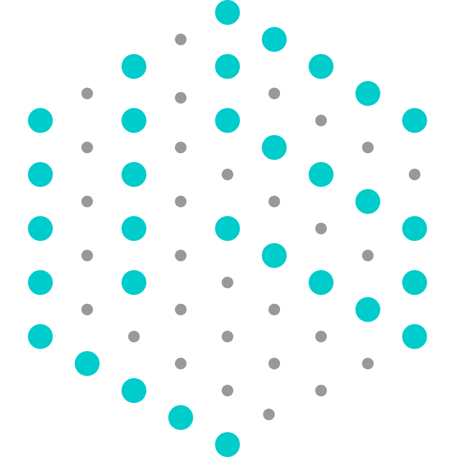

# LIS Calibration Tools



The `main.py` is the main calibration tool.
It provides options for
1. Data collection, namely charuco board and franka data for intrinsic/extrinsic calibration.
1. Intrinsic calibration (just calling opencv -- could be done equivalently directly in python)
1. Extrinsic calibration (using py bindings of a KOMO formulation)
1. Rendering synthetic images to overlay with the data and check alignment


## Installation

* Requires [robotic](https://github.com/MarcToussaint/robotic)


## KOMO Calibration Method (extinsic; jointly cams, arucos & joints via bundle adjustment)

### Input
The scene description is an important input to the method:
It needs to include definitions for all the cameras and all all aruco markers.
They should be roughly in the right position and orientation (+- 10cm), otherwise optimization is not well-behaved.

We assume that we collected data for T time slices from C cameras.
This makes a (T,C) array of images.
In each image we ran aruco detection, returning the 2D image coordinates of all aruco corners and their IDs.

To have good data, something needs to vary across time slices.
In the current setup this is the robot(s), on which are markers.
But the method can easily be changed to calibrate with markers on a free object (charuco board, or cube) that is placed randomly in each time slice.

The current method also takes as input the robot joint angles from each time slice.
This allows to co-calibrate the joint angles.
(If instead we'd use a free object, the solver would solve for the object pose freely in each time slice.)

`komo_calibrate` has arguments

* `C` the configuration, which is parsed for basler cams, arucos, and joints
* `pts`, a (T,C) array of (k,4,2) image coordinates of k aruco findings (4 corners each)
* `ids`, a (T,C) array of (k) integers (aruco ids)
* `qs`, a (T,n) array of joint vectors
* `exclude_times`, a list of time slices t to exclude from the optimization
* `calibrate_cams`, introduces static free (7D) calib dofs before each camera
* `calibrate_arucos`, introduces static xy-translation calib dofs before each aruco marker
* `calibrate_joints`, introduces static hingeX calib dofs before each robot joint (currently hacked? to be dofs 7-14?)
* `calib_joint_regularization`, a regularization to penalize too large joint re-calibrations

### What it solves
The methods solves for all introduced dofs by minimizing observation errors over all points, cameras, and time slices jointly.
The core objective is just these two lines:

      undistort_point(p, CS.Fxycxy(c), CS.Distortion(c));
      komo.addObjective({t+1.}, make_shared<F_PointView>(p, CS.Fxycxy(c)), { STRING("arc_"<<a <<"_" <<j), CS.cams(c)->name }, OT_sos, {1e2});

where p is the 2D point in camera c of the j-th corner of aruco a in time slice t.
The PointView is identical to PositionRel multiplied with the skew matrix

      x(0) = (p(0) - fxycxy(2)) / fxycxy(0);
      x(1) = (p(1) - fxycxy(3)) / fxycxy(1);
      x(2) = 1.;
      x_skew = skew(x);

This means the cross product of this vector x with the relative position of p in c-coordinates is penalized with SOS.
This objetive is standard in bundle adjustment.
If the camera poses would be the only dofs of this problem, there are more direct solution techniques (just solving and SVD).
However, as we want to jointly solve also for aruco and joint calib dofs, the generic formulation as KOMO NLP is convenient.

In addition to setting these objectives, all robot joint states in the KOMO path configuration are set to the provided `qs` and frozen (inactivated), while only calibration dofs are activated.
(When a free object is used as calibration variate, its joint state would be an active non-static dof, allowing KOMO to solve for its pose independently in each time slice in addition to the static calibration dofs.)

### What it outputs
Output are the optimal calibration transformations, but merged with the original transformation. (Technically, `f->parent->get_Q() * f->get_Q()` when f is the calibration dof.)

For convenience, these are output as yml-files that define edits of the original transformations and can directly be included in the scene description, namely `calib_cams.yml`, `calib_arucos.yml`, and `calib_joints.yml`.
	

## Helper methods

`scene_info`: Parse the provided scene for cams, arucos and joints, and output info on them -- allowing to understand what other methods do as first step.

`detect_arucos`: gets as input a (T,C) array of images; outputs (T,C) arrays of pts and ids, exactly as needed by the `komo_calibrate` method. (Fully cv2 based.)

`render_images`: gets as input a scene C (which is parsed for cams) and a (T,n) array of joint states; outputs a (T,C) array of rendered images for the T time slices and the C cameras, typically as wireframes so that they can be overlayed with the UNDISTORTED real images.
This is an ultimate test of consistency of everything (including interpretation of intrinsics as OpenGL cam).

`undistort_images`: gets as input a scene C (just to grab camera infos) and a (T,C) array of images, and undistorts them for overlay with the above. (Fully cv2 based.)

## Intrinsic Calibration

`calibrate_intrinsics`: gets as input a (T,C) array of images (with charuco boards presented to one or multiple cams in each time slice), and outputs the C intrinsic calibrations (also as yml-file).
The number of non-linear calibration dofs (2, 4, or 5) is an option.
Errors should be around 0.2 or smaller.
Run with more verbose to check images and charuco detections.
(Fully cv2 based.)


# Practical pipeline

1. Setup the scene config file, with cams, arucos, roughly positions. Use `ry-view` and `scene_info` to check.
1. Use `ry-view-baslers` to run cams (TODO: add option to continuously show charuco boards and/or aruco markers). Ensure framerate around 60Hz.
1. Position cameras. Upright. Aperture (Blende) not too bright (reduces Tiefenschärfe). Properly focus on center object.
1. Collect charuco board data
```
python3.py main.py -collect_board
```
1. Calibrate intrinsics
```
python3.py main.py -intrinsic
```
1. Collect franka calib data
```
python3.py main.py -collect_franka
```
1. Calibrate extrinsics and robot joints
```
python3.py main.py -extrinsic
```
1. Check with overlaying rendered and undistored images.
```
python3.py main.py -overlay
```
